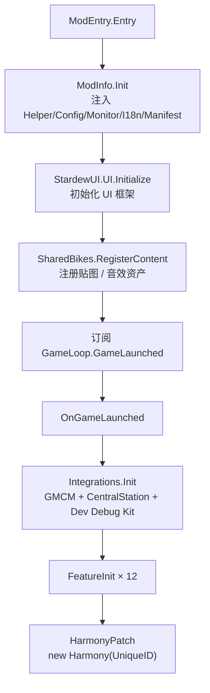

# Repository Guidelines

「Red Panda Bazaar（小熊猫集市）」——《星露谷物语》SMAPI 模组仓库的协作指南，供 AI 助手与协作者使用。

**工作语言：简体中文。** 注释、提交信息、文档一律中文；代码、标识符、路径、命令、报错原文保持原样。

---

## Project Overview

模组（Nexus 30982）由两个可独立安装的组件构成，二者通过地图名 / Tile Action 名 / 物品 ID 字符串硬耦合：

| 组件 | 目录 | 承担 |
|---|---|---|
| C# 模组 | `Red Panda Bazaar Code/` | 全部玩法逻辑：银行、玩家摊位、春季展览会与其小游戏、特殊订单、交通、共享单车、抽奖机、俄罗斯方块小游戏、菜单界面 |
| Content Patcher 内容包 | `[CP]Red Panda Bazaar/` | 地图 TMX、NPC、商店、节日、邮件、物品定义与全部美术资源 |

C# 侧 `manifest.json` 把 CP 包 `Lilaoliu.RedPandaBazaar` 标为 `IsRequired: true`，缺失会硬报错。CP 包由他人维护，**本仓库只读**；CP 更新不随构建自动同步，需手动处理。

技术栈：C# / `net6.0` / SMAPI 4.x / Harmony（可选 GMCM、Central Station、Dev Debug Kit 软依赖）。

**UI 框架是 StardewUI.Core**（`Projects/StardewUI/Core`，共享源码项目，命名空间 `StardewUI.*`，通过 csproj 的 `<Import>` 编译期注入）：菜单基类 `ViewMenu`，构件与布局在 `StardewUI.Widgets` / `StardewUI.Layout`，`Core/ViewMenu.cs:784` 的 `update` 之类钩子在子类里重写。

本 mod 的通用实现（`Tools`、`ItemSerializer`、`RandomUtils`、`TimeUtils`）位于本仓库 `Utils/`；`PatchType` 等常量类位于 `Constant/`；GMCM 接口声明位于 `Compatibility/ModApi/`。本 mod 不再通过 Shared Project 依赖仓库外的 `MySDVMods/Common`；该目录中的旧 UI 框架仍供其它 mod 使用，本 mod 不参与编译。mod 专属信息（Helper/配置/Monitor 等）在 `Utils/ModInfo.cs`。

---

## Architecture & Data Flow

### 启动链（`ModEntry.cs`）



- `Entry` 只做 `ModInfo.Init` + `StardewUI.UI.Initialize` + `SharedBikes.RegisterContent` + 订阅 `GameLaunched`，**不要**在此添加其它逻辑。
- `StardewUI.UI.Initialize(helper, Monitor)` 必须先于任何菜单构造（Core 内部要注入 Helper 并订阅 `GameLoop` 事件）；漏掉会在打开菜单时抛 `InvalidOperationException`。
- `SharedBikes.RegisterContent()`（订阅 `Content.AssetRequested`）也必须在这里调用：游戏启动早期就会加载 `Data/AudioChanges`，订阅晚了的 `e.Edit` 不会执行（CP 同样在 Entry 订阅该事件）。这是「Entry 不放业务逻辑」的唯一例外，新增同类需求照此办理。
- `FeatureInit()`（`ModEntry.cs:44-57`）按 `Bank → Buffs → Critter → Furniture → SpringFair → PlayerStall → PrizeMachines → SpecialOrders → ButterflyNight → Transportation → SharedBikes → TetrisFeature` 顺序调用各 Feature 的 `Init()`；新功能在末尾追加。
- `HarmonyPatch()` 依次 `SpringFairPatch` → `BuffsPatch` → `SpecialOrdersPatch` → `FurniturePatch` → `SharedBikesPatch`。

### 核心机制

| 机制 | 说明 |
|---|---|
| **`ModInfo` + `Utils.Tools`** | `Utils/ModInfo.cs` 存本 mod 专属信息（Helper/ModConfig/Monitor/I18n/ModManifest），启动时注入本地工具运行时；通用函数（日志 `Log*`、翻译 `GetI18n`、扣款 `TryCharge`、多人 `SendToHostOrBroadcast`、`IsGoodWeather`/`IsValidButtonAction`）集中在 `Utils/Tools.cs`。**不要**新增第二个服务定位器，也不要往业务类里传 `IModHelper` |
| **Feature 自治** | `Features/<Name>/` 每个目录一个独立功能，暴露 `public static void Init()`，自行订阅事件、注册 Tile Action、持有自己的 `*Data.cs` 与菜单。需要向游戏内容管线注册资产的功能（现仅 `SharedBikes`）额外暴露 `RegisterContent()`，由 `Entry` 调用 |
| **主机权威多人模型** | 改世界 / 改金币 / 结算只由 `Context.IsMainPlayer` 执行；客机发请求或收广播。消息类型集中在 `Constant/MPMessageType.cs` |
| **事件优于补丁** | 决策阶梯：`Data/` 表 → SMAPI 事件 → 已有 API → 扩展点 → Prefix/Postfix → Transpiler（最后手段）。目前全仓仅 5 个补丁类共 12 处 Harmony 补丁 |
| **UI 框架（StardewUI.Core）** | 菜单继承 `ViewMenu` 并实现 `CreateView()` 返回视图树；`Frame` + `Lane` + `Label`/`Button` 拼出窗口，Measure/Arrange 两段式布局与手柄焦点导航由框架负责。窗口外观与常用构件的工厂方法集中在 `Utils/MenuUi.cs`，新菜单必须复用它 |

### 数据流

```
玩家交互 → SMAPI 事件 / Tile Action → Feature 静态类
  → 修改内存状态（ModInfo.Helper.Data.ReadSaveData 得到的内存对象）
  → GameLoop.Saving 时落盘（仅主机）
  → 变更如需同步，Tools.SendToHostOrBroadcast 广播 / 定向发送
```

---

## Key Directories

| 路径 | 用途 |
|---|---|
| `Red Panda Bazaar Code/ModEntry.cs` | SMAPI 入口，仅 4 个方法 |
| `Red Panda Bazaar Code/Utils/` | 本 mod 的本地公共实现：`ModInfo.cs`、`MenuUi.cs`、`Tools.cs`、`ItemSerializer.cs`、`RandomUtils.cs`、`TimeUtils.cs` |
| `Red Panda Bazaar Code/Features/` | 12 个功能模块，每个自成一目录（`Bank/`、`PlayerStall/`、`SpringFair/`、`Buffs/`、`Furniture/`、`Transportation/`、`Critters/`、`SpecialOrders/`、`PrizeMachines/`、`SharedBikes/`、`ButterflyNight/`、`Tetris/`） |
| `MySDVMods/Common/`（仓库外） | 旧共享源码项目；本 mod 不引用它，本仓库内也已无其它 mod 引用（仅仓库外的 `PrizeMachineFramework` 仍在消费） |
| `Projects/StardewUI/Core/`（仓库外） | UI 框架源码（`ViewMenu`/`View`/`Widgets`/`Layout`），csproj 的 `StardewUICorePath` 指向它；框架本身有改动时需回归本 mod |
| `Red Panda Bazaar Code/docs/` | `StardewUI-Core-Api-Cheatsheet.md`——本 checkout 版 StardewUI.Core 的纯代码 API 速查（含"不存在"清单与源码行号），写新菜单前先查它；`SpringFair-Minigame-Invocation.md`——春季展览会复用原版小游戏的方案取舍与适配点 |
| `Red Panda Bazaar Code/DeBug/` | `Debug.cs`——本模组专属调试 UI 的开关查询入口，转发到 Dev Debug Kit 的 API（未安装时恒为 false） |
| `Red Panda Bazaar Code/Compatibility/` | 可选集成：`Integrations.cs`（GMCM + Central Station + Dev Debug Kit）、`ModApi/`（第三方 API 接口声明） |
| `Red Panda Bazaar Code/Constant/` | `I18nKeys`、`ItemsKeys`、`MPMessageType`、`StatsKeys`、`QuestsKeys`、`SkillsKeys`、`DataKeys`、`PatchType` |
| `Red Panda Bazaar Code/Config/` | `ModConfig.cs`（2 个配置项：萤火虫数量倍率、抽奖机动画速度倍率） |
| `Red Panda Bazaar Code/i18n/` | `default.json`（英文）+ `zh.json`（中文），**必须同步维护** |
| `Red Panda Bazaar Code/assets/` | C# 侧资源：6 个纹理 PNG（`Textures/`）+ 2 个 Ogg 音效（`Audio/`，共享单车起步与骑行循环音），经 `Content.AssetRequested` / `Data/AudioChanges` 注册 |
| `Red Panda Bazaar Code/scripts/` | `ValidateRepo.py`（CI 与本地共用的静态校验脚本）、`MakeRcVersion.py`（CD 发布时派生 RC 版本号） |
| `[CP]Red Panda Bazaar/` | **只读**：地图、NPC、商店、节日、物品定义、美术资源 |

---

## Development Commands

> ⚠️ **构建有副作用，动手前务必读本节。**

```bash
# 常规构建（部署到 Mods + 打包 zip，见下表）
dotnet build "Red Panda Bazaar Code/Red Panda Bazaar Code.csproj"
dotnet build "Red Panda Bazaar Code.sln"                    # 等价
dotnet build -c Release "Red Panda Bazaar Code/Red Panda Bazaar Code.csproj"

# 仅编译检查（不部署、不打包，零副作用）
dotnet build "Red Panda Bazaar Code/Red Panda Bazaar Code.csproj" -p:EnableModDeploy=false -p:EnableModZip=false
```

| 副作用 | 触发时机 | 说明 |
|---|---|---|
| 重新部署 CP 包到 `Mods/`（`DeployCP`） | BeforeBuild | 以仓库内 `[CP]Red Panda Bazaar/` 为源，先 `rmdir /s /q` 再全量拷贝；`EnableModDeploy=false` 时跳过 |
| 编译产物 → `out\` + 打包 zip | Build | zip 名绑定构建版本，反复构建会在 `out/net6.0/` 堆积；`EnableModZip=false` 时只产出 dll |

**构建不会改写任何仓库文件**：版本号只来自 csproj 的 `<Version>`，`manifest.json` 写 `%ProjectVersion%` 占位符，由 ModBuildConfig 在打包时替换。只想验证编译时传入 `-p:EnableModDeploy=false -p:EnableModZip=false` 即可做到零副作用，无需事后还原文件或清理 zip。CI 的编译检查正是这么跑的（见「Testing & QA」）。

产物路径：`Red Panda Bazaar Code/out/net6.0/Red Panda Bazaar Code.dll`。

**本地构建会自动带上来源代码标识**：`AppendGitRevision` Target 在构建期用 `git rev-parse --short HEAD` 取短 SHA，配合 `git status --porcelain` 判断是否有未提交改动（含新增未跟踪文件），把结果作为 semver build metadata 追加到 `<Version>`：干净工作区是 `1.2.0-Beta+04e0518`，有改动是 `1.2.0-Beta+04e0518-dirty`。zip 名、`manifest.json` 的版本号、程序集版本三处同步带标识，发给人之前看一眼文件名即可确认打包的是哪份代码，`-dirty` 则提示「改了没提交就打包」。

- build metadata 不参与版本优先级比较（semver 2.0），因此不会被 SMAPI 误判为新版本；`manifest.json` 里仍是合法的语义化版本（SMAPI 的 `SemanticVersion.BuildMetadata` 专门支持该段）。
- 该 Target 只在 `<Version>` 不含 `+` 时生效，CI 经 `-p:Version=` 注入 RC 版本号时用 `-p:AppendGitRevision=false` 显式关闭（build metadata 的 `+` 在下载 URL 中会被解码成空格，RC 的产物名与下载链接保持无 `+`）。
- 非 git 工作副本（如导出的源码包）里 git 命令会输出错误信息，SHA 用正则提取校验，取不到时版本号安全退回 csproj 中的值。

---

## Code Conventions & Common Patterns

### 硬性规则

- **优先复用 `Utils/` 中的工具类**，避免重复造轮子。
- **菜单界面必须使用 StardewUI.Core**（`Projects/StardewUI/Core`）：菜单继承 `ViewMenu` 并实现 `CreateView()`，窗口与构件走 `Utils/MenuUi.cs` 的工厂方法；**禁止**直接使用星露谷原版的 `IClickableMenu`，也不要自造布局系统（确需自绘时按 `TetrisViews.cs` 的写法继承 `StardewUI.View`，重写 `OnMeasure` / `OnDrawContent`）。
  *已知例外（勿扩散）：`PlayerStallMenu : MenuWithInventory`（需背包交互）、`ClassicPrizeMachineMenu` / `JojaPrizeMachineMenu : IClickableMenu`、`SpecialOrderBoard : SpecialOrdersBoard`。*
- **配置界面使用 `IGenericModConfigMenuApi`**，并通过 `Compatibility/Integrations.cs` 统一注册。
- **禁止修改 `[CP]Red Panda Bazaar/` 下的任何文件**（Content Patcher 内容包）。它由他人维护，上游更新会整目录覆盖本地改动。
- **新的 i18n 条目必须放在对应的版本注释下**，不能直接追加到文件末尾。
- 每次提交时，需提交所有已跟踪文件（即未被 `.gitignore` 标注的文件）。

### 新增功能的标准姿势

1. 在 `Features/<Name>/` 新建静态类，暴露 `public static void Init()`，首尾各一行 `Tools.Log("<Name> Initializing.")` / `Inited.`。
2. 在 `ModEntry.FeatureInit()` 末尾追加调用。
3. 面向玩家的文本走 `Tools.GetI18n(I18nKeys.X)`；常量加进 `Constant/I18nKeys.cs` 对应 `#region`。
4. 物品 / 机器 / 家具 ID 加进 `Constant/ItemsKeys.cs` 的嵌套类，不要散落字符串。

### Harmony 补丁模板

五个补丁类（`Features/*/XxxPatch.cs`，共 12 处：SpringFair 4、Buffs 2、SpecialOrders 2、Furniture 3、SharedBikes 1）形态完全一致，照抄：

```csharp
public static class XxxPatch {
    private const string NAME = nameof(XxxPatch);

    public static void ApplyPatch(Harmony harmony) {
        Tools.LogPatch(NAME, "Type.method()", PatchType.Prefix);
        harmony.Patch(
            original: AccessTools.Method(typeof(Type), nameof(Type.method)),   // 非公开方法用字符串名
            prefix: new HarmonyMethod(typeof(XxxPatch), nameof(Prefix_Type_method))
        );
    }

    private static bool Prefix_Type_method(Type __instance) {
        try {
            /* 先判身份：不是自己管的对象立刻 return true 放行 */
            return true;
        } catch (Exception e) {
            Tools.LogPatchErr(NAME, e);
            return true;   // 异常时放行，绝不阻断原方法
        }
    }
}
```

- 方法命名 `Prefix_{Type}_{method}` / `Postfix_{Type}_{method}`，补丁方法一律 `private static`。
- 被重写遮蔽时改补父类，并写注释说明（见 `FurniturePatch.cs:21-33`，`clicked` 补 `Furniture` 基类、`canBeRemoved` 补 `StorageFurniture` 基类）。
- 补丁参数名必须与原方法**完全一致**；用 `AccessTools.Method(type, name, new[] { typeof(...) })` 精确定位重载。

### 多人同步

```csharp
// 发送：主机广播全部，客机定向发主机
Tools.SendToHostOrBroadcast(data, MPMessageType.PlayerStall_AddItem);

// 接收
private static void OnModMessageReceived(object? sender, ModMessageReceivedEventArgs e) {
    if (e.FromModID != Tools.ModManifest.UniqueID) return;
    switch (e.Type) {
        case MPMessageType.PlayerStall_SyncData:
            if (Context.IsMainPlayer) break;
            Data = e.ReadAs<StallSaveData>();
            break;
    }
}
```

- 新消息类型加进 `Constant/MPMessageType.cs` 并按模块注释分组。
- 定向回复用 `playerIDs: new[] { e.FromPlayerID }`。
- **`PerScreen<T>` 只用于按屏隔离的纯表现状态**（如 `Critters` 的粒子计数），世界状态用主机权威 + 广播。

### 存档与状态

| 动作 | 判据 | 位置 |
|---|---|---|
| 读存档 | `Context.IsOnHostComputer` | `GameLoop.SaveLoaded` |
| 写存档 | `Context.IsMainPlayer` | `GameLoop.Saving` |
| 改世界 / 结算 | `Context.IsMainPlayer` | 各 Feature 的事件处理器 |

- 判据区别：`IsMainPlayer` = 屏幕 0 上的权威玩家；`IsOnHostComputer` = 存档在本机（分屏第二玩家为真）。**访问存档 API 必须用后者** —— SMAPI 的 `ReadSaveData`/`WriteSaveData` 内部就是按 `IsOnHostComputer` 校验，用错会抛 `InvalidOperationException`。
- 存档 key 常量集中在 `Constant/StatsKeys.cs`，前缀 `WhaleK233.RedPandaBazaar.`。
- `OnSaveLoaded` 中先 `Data = new T()` 重置跨存档状态，再按判据读取。
- **跨存档 / 跨网络传物品一律走 `Utils.ItemSerializer` 的 XML 快照**（`ItemSnapshot` 模式），数量以快照的 `Item.Stack` 为准，不要另存数量字段；惰性访问器写成**方法**（`GetItem()`）而非属性，否则会被 JSON 序列化器写回存档。

### UI 框架

```csharp
public class MyMenu : ViewMenu
{
    private Lane? _content;   // 需要按数据重建时保留引用（ViewMenu 没有 Rebuild）

    protected override IView CreateView()
    {
        CloseButtonSprite = UiSprites.CloseButton;   // 右上角关闭按钮
        _content = MenuUi.Column();                  // 宽度撑满内容区、高度自适应
        RebuildContent();
        return MenuUi.Window(_content);              // 菜单底色 + 边框，尺寸随内容自适应
    }

    private void RebuildContent()
    {
        if (_content is null) return;
        _content.Children.Clear();                   // 数据变了就整体重建，视图不持有状态

        _content.Children.Add(MenuUi.Header("标题"));

        var buttonRow = MenuUi.Row(topMargin: MenuUi.RowGap);
        buttonRow.Children.Add(MenuUi.PrimaryButton("确定", Close));
        _content.Children.Add(buttonRow);
    }
}
```

- `CreateView()` 在 `ViewMenu` 构造期被调用。C# 先执行实例字段初始化器、再调用基类构造函数，所以派生类字段此时已可用，但派生类**构造函数体**尚未执行——视图相关初始化（`CloseButtonSprite`、事件订阅、控件引用）写在 `CreateView` 里最稳。
- 重建视图树 = `Children.Clear()` + 重新 `Add`；`ViewMenu` 每帧 `MeasureAndCenterView()` 会自动重测并重新居中，尺寸变化无需手动处理。
- 行内元素间距用 `Margin`（`Lane` **没有** `Spacing`/`ItemSpacing` 属性）；列内行间距用 `MenuUi.Row(..., topMargin)`，常规行距取 `MenuUi.RowGap`（=6，对齐旧 `UiColumn.Spacing`）；"文本左 + 控件贴右端"的行用 `MenuUi.RowBetween`（左侧文本设 `Length.Stretch()` 吃掉剩余宽度）；长列表用 `ScrollableView`（自身尺寸须固定）。
- 文本自动换行始终开启，水平对齐用 `Label.HorizontalAlignment`（宽度需大于文本）；`Button` 默认参与手柄焦点导航。
- `MenuUi` 是本 mod 菜单的唯一视觉设计系统：外层使用 `Window`，页面标题使用 `Header`，相关信息使用 `Card` 分组；操作按钮按重要性使用 `PrimaryButton` / `SecondaryButton`，不要在菜单中散落背景贴图、颜色和间距常量。
- 数据型页面必须区分信息层级：关键数值使用较大或加粗文本，提示与单位使用 `MenuUi.Muted`；状态颜色只表达正向、警告或锁定含义，不把颜色当作唯一信息来源。
- 表格使用 `Grid` 的 `GridItemLayout.Count` 配合响应式 `Length.Stretch()`，表头与数据行共用同一 Grid；长列表放进有固定高度的 `ScrollableView`，禁止用固定像素列坐标模拟表格。
- 重建列表时只重建数据区域；实时变化的数值保留 `Label` 引用更新，避免每帧清空视图树导致焦点和输入状态丢失。
- 自绘内容（如俄罗斯方块棋盘）必须包在 `Frame` / `Card` 外壳内，并按视口计算尺寸；不得让自绘控件自行决定整个菜单的外观和关闭逻辑。

### i18n

```json
// i18n/default.json 与 i18n/zh.json —— 同键、同序、占位符同名
{
  /****** Version 1.2.0 Added ******/
  "PlayerStall.TotalTax": "Total Tax: {{amount}}{{gold}}",
```

```json
  /****** Version 1.2.0 Added ******/
  "PlayerStall.TotalTax": "历史总税收: {{amount}}{{gold}}",
```

```csharp
public const string PlayerStall_TotalTax = "PlayerStall.TotalTax";   // Constant/I18nKeys.cs
var msg = Tools.GetI18n(I18nKeys.PlayerStall_TotalTax)
    .Tokens(new { amount = totalTax, gold }).ToString();
```

- 文件顶部是**倒序版本块**（最新在上），新键挂进对应版本块；无新增时新建一块置于最上方。
- **删除键**要在发生删除的版本块内留一行履历：`/****** Delete "Key1", "Key2" ******/`（键名保持英文），再从两份 JSON 与 `I18nKeys.cs` 中移除。
- 占位符名（`{{amount}}`、`{{gold}}`、`{{rate}}`）必须与 `.Tokens(new { ... })` 的匿名属性名一致。
- 两份 JSON 的键集合与顺序必须逐行一致；文件含 `/* */` 注释属正常，SMAPI 可解析。

---

## Important Files

| 文件 | 为什么重要 |
|---|---|
| `Red Panda Bazaar Code/ModEntry.cs` | 唯一入口；启动链与补丁注册点 |
| `Red Panda Bazaar Code/Utils/ModInfo.cs` | 本 mod 专属信息（Helper/配置/Monitor/翻译/清单），启动时注入 `Utils.Tools` |
| `Red Panda Bazaar Code/Utils/MenuUi.cs` | StardewUI 构件工厂（窗口/行/列/文本/按钮/分隔线），所有菜单共用 |
| `Projects/StardewUI/Core/ViewMenu.cs`（仓库外） | 菜单基类：输入分发、焦点导航、每帧测量与居中都在这里 |
| `Red Panda Bazaar Code/Utils/ItemSerializer.cs` | 物品 XML 快照；跨存档/网络传物品的唯一正确途径 |
| `Red Panda Bazaar Code/Compatibility/Integrations.cs` | GMCM 配置注册与 Central Station 集成，可选依赖的统一入口 |
| `Red Panda Bazaar Code/Constant/MPMessageType.cs` | 多人消息类型常量 |
| `Red Panda Bazaar Code/Constant/StatsKeys.cs` | 存档 key 与游戏统计 key |
| `Red Panda Bazaar Code/Red Panda Bazaar Code.csproj` | 版本号唯一来源（`<Version>`）与两个自定义 Target（`DeployCP`、`AppendGitRevision`）都在这里，改动前先读 `Development Commands` |
| `Red Panda Bazaar Code/manifest.json` | `Version` 为 `%ProjectVersion%` 占位符，实际值由 csproj `<Version>` 在打包时替换 |
| `Red Panda Bazaar Code/scripts/MakeRcVersion.py` | CD 发布用：由 csproj `<Version>` 派生 `x.y.z-rc.<日期>.<run>`，只输出到 stdout，不改写文件 |
| `.github/workflows/ci.yml` | CI/CD 入口：`validate` 跑 `ValidateRepo.py`；`build` 用参考程序集在 Linux 上编译；`release` 在校验与编译都通过后发布 RC |
| `.github/actions/setup-build/action.yml` | 复合 action：安装 .NET SDK、游戏参考程序集与 StardewUI，CI 与 CD 共用 |
| `Red Panda Bazaar Code/i18n/default.json` | 翻译基准，结构即规范 |
| `[CP]Red Panda Bazaar/content.json` | CP 侧入口：`CustomLocations` 注册地图、`Changes` 拼装数据 |

---

## Runtime/Tooling Preferences

| 项 | 要求 |
|---|---|
| 运行时 / TFM | **`net6.0`，不要升级**（SMAPI 4.x 本身即 net6.0） |
| 构建工具 | `dotnet` CLI 或 Rider / Visual Studio |
| 构建助手 | `Pathoschild.Stardew.ModBuildConfig` 4.4.0（唯一 NuGet 依赖），自动探测游戏目录并引用游戏与 SMAPI 程序集，含 `0Harmony.dll`（因 `EnableHarmony=true`） |
| **`python`** | 必须在 `PATH`：CI 校验跑 `ValidateRepo.py`，CD 发布前跑 `MakeRcVersion.py` 派生 RC 版本号；本地构建不再调用任何 python 脚本 |
| **GitHub Actions 权限** | `ci.yml` 顶层 `contents: read`；仅 `release` job 单独提权到 `contents: write`，用于创建 / 刷新 Release |
| **`MySDVMods/Common`** | 本 mod 不再依赖；仅当其它接入 mod 需要共享源码时维护该目录 |
| **`Projects/StardewUI/Core`** | StardewUI.Core 源码，csproj 的 `StardewUICorePath` 默认 `..\..\..\..\Projects\StardewUI\Core`（相对项目目录向上四级；本机 checkout 中即 `Codes\Projects\StardewUI\Core`），可用同名属性覆盖；缺失则构建硬失败 |
| **C# 语言版本 / Newtonsoft** | StardewUI 源码用了 C# 12 语法，csproj 因此设 `<LangVersion>Latest</LangVersion>`；其 Data 解析依赖 SMAPI 内置的 `$(GamePath)\smapi-internal\Newtonsoft.Json.dll`（csproj 里显式 `<Reference>`），二者都不要删 |
| 游戏安装 | 必须能被 ModBuildConfig 自动探测到（注册表 / 常见路径），否则构建报错 |
| 外部源 | NuGet 需可还原 `Pathoschild.Stardew.ModBuildConfig`；离线时首次构建可能失败 |

版本号只写在 `Red Panda Bazaar Code.csproj` 的 `<Version>`（本地开发格式 `x.y.z-Beta`）。`manifest.json` 的 `Version` 写 `%ProjectVersion%` 占位符，ModBuildConfig 打包时替换为实际值；程序集版本也由它派生。本地构建由 `AppendGitRevision` Target 追加 `+<短SHA>[-dirty]`（见「Development Commands」）。CD 发布的 RC 包版本为 `x.y.z-rc.<日期>.<run>`（run = GitHub Actions 运行号），由 `MakeRcVersion.py` 派生后经 `-p:Version=` 注入构建，不写回仓库。构建过程**不会改写任何仓库文件**。

---

## Testing & QA

**自动化测试是 Python 标准库 `unittest`**：`Red Panda Bazaar Code/tests/` 覆盖 `ValidateRepo.py` 的 JSONC 解析辅助函数、`MakeRcVersion.py` 的版本号派生，并对当前检出副本运行完整仓库校验作为冒烟测试。CI 的 `validate` job 会在校验脚本之后运行它们。

仓库一致性校验（静态检查）与单元测试的本地入口：

```bash
# 校验：JSON 可解析性与重复键、i18n 双文件键集合 / 顺序 / 占位符、
# I18nKeys.cs 与 default.json 双向对应、manifest 字段与版本号占位符、
# csproj 的 TFM 与 Version、以及 PR 中 [CP]Red Panda Bazaar/ 是否被改动
python "Red Panda Bazaar Code/scripts/ValidateRepo.py"
python -m unittest discover -s "Red Panda Bazaar Code/tests" -t "Red Panda Bazaar Code" -p "test_*.py" -v
```

`.github/workflows/ci.yml` 在 `main` / `develop` 的 push 与 PR 上运行：

- **仓库一致性校验与单元测试**（`validate`）：跑上面的 `ValidateRepo.py` 与 `tests/` 下的 `unittest` 测试。PR 中 `[CP]Red Panda Bazaar/` 改动会失败，同步上游时给 PR 打上 `cp-change-approved` 标签即可豁免。
- **编译检查**（`build`）：在 `ubuntu-latest` 上编译整个模组（0 error 门槛）。runner 上没有游戏本体，靠三样东西补齐：
  1. `StardewModders/mod-reference-assemblies` 的公开 API 空壳（经 `Pathoschild/SMAPI-ModBuildWorkflow/add-reference-assemblies@v1` 克隆到 `$GITHUB_WORKSPACE/_game`）；
  2. 克隆 `Mushymato/StardewUI`（`dev-unofficial` 分支）作为 UI 框架源码；
  3. `-p:EnableModDeploy=false -p:EnableModZip=false` 关掉全部副作用。

  这两项环境准备抽在复合 action `.github/actions/setup-build/action.yml` 里，CI 与 CD 共用，避免两处编译条件漂移。`-p:GamePath` 与 `-p:StardewUICorePath` 均显式指向上述目录，不依赖 ModBuildConfig 的自动探测。

  **SDK 版本**：StardewUI 用到 C# 13/14 语法（`ref struct` 接口等），net6.0 SDK 自带的 C# 10 编译不过，因此用 `actions/setup-dotnet` 装较新的 SDK，而不是 `add-build-environment`（它会把 SDK 固定回 6.0）。
- **RC 发布**（`release`，CD）：仅在 **push 到 `develop`** 且前两个 job 都通过后运行。构建出 `x.y.z-rc.<日期>.<run>` 版本的 zip 并刷新**同一条** GitHub Release（tag 固定 `rc`）——release 与 tag 永不删除，只原地更新标题、说明与产物，保证玩家手里的下载链接不中断。

  **同一条 release 的实现要点**：`gh release delete` 会造成下载链接的中间态中断，因此用 `gh release edit` + `gh release upload` 原地刷新，并先清掉上一轮资产避免堆积。CD 需要 `contents: write`（`ci.yml` 顶层仍是 `contents: read`，只有 `release` job 单独提权）。

  **不要标记 prerelease**：GitHub 规定 prerelease 永远不能成为 latest（Releases API `make_latest` 说明："Drafts and prereleases cannot be set as latest"）。一旦打上该标记，`/releases/latest` 会返回 404，release 页面也不再显示 Latest 徽标。因此创建与刷新都显式传 `--latest`。

  **首页侧栏的 Releases 区块由仓库设置控制**，与 release 是否存在无关：仓库首页 About → 齿轮 → 勾选 "Releases" → Save。该开关不在 REST / GraphQL API 中，只能网页操作；未勾选时首页右栏整块不渲染（页面数据里 `"sections":{"releases":false}`），但 `/releases` 页面与下载链接始终正常。

其余验证方式是**编译 + 游戏内人工确认**：

```bash
# 能做到的自动验证：编译通过（0 error），零副作用
dotnet build "Red Panda Bazaar Code/Red Panda Bazaar Code.csproj" -p:EnableModDeploy=false -p:EnableModZip=false
```

改动完成后，交付前至少要保证编译通过；涉及游戏内行为的部分，需**列出可执行的验证清单**交给开发者在游戏内确认，而不是声称已验证。

**调试设施**：通用调试功能（可视化开关、Tile Action 高亮、调试菜单、光标传送）已拆分到独立模组 **Dev Debug Kit**（`WhaleK233.DevDebugKit`，位于本仓库之外 `MySDVMods/Dev Debug Kit/`），键位在其 GMCM 中配置。本模组仅保留专属调试 UI（摊位菜单的 Action ID 叠层），经 `Integrations.Installed.DevDebugKitApi` 读取其开关状态（未安装时自动关闭），自己不再有任何调试配置项。

**已知的仓库卫生问题**（改动时顺带注意，不要扩散）：

- `README.md` 与代码有多处不一致：功能列表仍列着已删除的 `FishingMiniGame/`、`TargetMiniGame/`，且缺 `Bank/`、`SharedBikes/`、`Tetris/`；未提及构建副作用（CP 部署等）；称 CP 包仅为「美术资源」。
- `out/net6.0/` 的历史 zip 随构建持续堆积（已 gitignore），定期清理。
- `MySDVMods/Common/UI/`（旧自研 UI 框架，约 34 个文件）在本仓库内已无消费者：本 mod 与 `Dev Debug Kit` 都已迁到 StardewUI.Core。是否整目录删除、以及是否清理 `Common/WhaleK.Common.projitems` 里的 `UI Framework` 组，留给维护者决定（仓库外的 `PrizeMachineFramework` 仍在消费 `Common`）。
