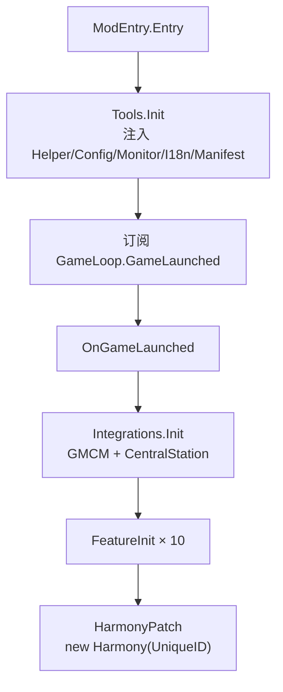

# Repository Guidelines

「Red Panda Bazaar（小熊猫集市）」——《星露谷物语》SMAPI 模组仓库的协作指南，供 AI 助手与协作者使用。

**工作语言：简体中文。** 注释、提交信息、文档一律中文；代码、标识符、路径、命令、报错原文保持原样。

---

## Project Overview

模组（Nexus 30982）由两个可独立安装的组件构成，二者通过地图名 / Tile Action 名 / 物品 ID 字符串硬耦合：

| 组件 | 目录 | 承担 |
|---|---|---|
| C# 模组 | `Red Panda Bazaar Code/` | 全部玩法逻辑：银行、玩家摊位、小游戏、特殊订单、交通、抽奖机、自研 UI 框架 |
| Content Patcher 内容包 | `[CP]Red Panda Bazaar/` | 地图 TMX、NPC、商店、节日、邮件、物品定义与全部美术资源 |

C# 侧 `manifest.json` 把 CP 包 `Lilaoliu.RedPandaBazaar` 标为 `IsRequired: true`，缺失会硬报错。CP 包由他人经 SVN 维护，**本仓库只读**；CP 更新不随构建自动同步，需手动执行 SVN 流程（见 `Development Commands`）。

技术栈：C# / `net6.0` / SMAPI 4.x / Harmony（可选 GMCM、Central Station、Dev Debug Kit 软依赖）。

公共源码（自研 UI 框架、`ItemSerializer`、`RandomUtils`、`TimeUtils`、`PatchType`、GMCM 接口声明、通用 `Tools` 函数）在仓库之外的共享项目 **`MySDVMods/Common`**（命名空间 `WhaleK.Common`，MSBuild Shared Project 编译期注入，csproj 经 `<Import>` 引用）；该目录缺失时本仓库无法编译。mod 专属信息（Helper/配置/Monitor 等）在 `Utils/ModInfo.cs`，启动时经 `ModInfo.Init` 注入公共运行时。

---

## Architecture & Data Flow

### 启动链（`ModEntry.cs`）



- `Entry` 只做 `Tools.Init` + 订阅 `GameLaunched`，**不要**在此添加逻辑。
- `FeatureInit()`（`ModEntry.cs:36-47`）按 `Bank → Buffs → Critter → Furniture → SpringFair → PlayerStall → PrizeMachines → SpecialOrders → ButterflyNight → Transportation` 顺序调用各 Feature 的 `Init()`；新功能在末尾追加。`FishingMiniGame/` 与 `TargetMiniGame/` 是例外：二者为 `IMinigame` 小游戏，没有 `Init()`，前者经 Harmony 补丁接入、后者由 SpringFair 启动。
- `HarmonyPatch()` 依次 `FishingMiniGamePatch` → `BuffsPatch` → `SpecialOrdersPatch` → `FurniturePatch`。

### 核心机制

| 机制 | 说明 |
|---|---|
| **`ModInfo` + `WhaleK.Common.Tools`** | `Utils/ModInfo.cs` 存本 mod 专属信息（Helper/ModConfig/Monitor/I18n/ModManifest），启动时注入公共运行时；通用函数（日志 `Log*`、翻译 `GetI18n`、扣款 `TryCharge`、多人 `SendToHostOrBroadcast`、`IsGoodWeather`/`IsValidButtonAction`）在共享项目的 `WhaleK.Common.Tools`。**不要**新增第二个服务定位器，也不要往业务类里传 `IModHelper` |
| **Feature 自治** | `Features/<Name>/` 每个目录一个独立功能，暴露 `public static void Init()`，自行订阅事件、注册 Tile Action、持有自己的 `*Data.cs` 与菜单（例外：`FishingMiniGame/`、`TargetMiniGame/` 是 `IMinigame` 小游戏，无 `Init()`） |
| **主机权威多人模型** | 改世界 / 改金币 / 结算只由 `Context.IsMainPlayer` 执行；客机发请求或收广播。消息类型集中在 `Constant/MPMessageType.cs` |
| **事件优于补丁** | 决策阶梯：`Data/` 表 → SMAPI 事件 → 已有 API → 扩展点 → Prefix/Postfix → Transpiler（最后手段）。目前全仓仅 4 个补丁类共 9 处 Harmony 补丁 |
| **自研 UI 框架** | `WhaleK.Common.UI`（共享项目 `MySDVMods/Common`）提供声明式菜单（`UiBaseMenu` + 组件树 + Measure/Arrange 两段式布局 + 手柄焦点导航），新菜单必须使用 |

### 数据流

```
玩家交互 → SMAPI 事件 / Tile Action → Feature 静态类
  → 修改内存状态（ModInfo.Helper.Data.ReadSaveData 得到的内存对象）
  → GameLoop.Saving 时落盘（仅主机）
  → 变更如需同步，Tools.SendToHostOrBroadcast 广播 / 定向发送
```

---

## Key Directories

| 路径 | 用途 |
|---|---|
| `Red Panda Bazaar Code/ModEntry.cs` | SMAPI 入口，仅 4 个方法 |
| `Red Panda Bazaar Code/Utils/` | `ModInfo.cs`（mod 专属信息）；物品序列化、随机、时间工具与通用函数已移至共享项目 `MySDVMods/Common` |
| `Red Panda Bazaar Code/Features/` | 12 个功能模块，每个自成一目录（`Bank/`、`PlayerStall/`、`SpringFair/`、`Buffs/`、`Furniture/`、`Transportation/`、`Critters/`、`SpecialOrders/`、`PrizeMachines/`、`FishingMiniGame/`、`TargetMiniGame/`、`ButterflyNight/`） |
| `MySDVMods/Common/`（仓库外） | 共享源码项目：`WhaleK.Common.UI`（`UiBaseMenu` + 11 组件 + 枚举）、`ItemSerializer`、`RandomUtils`、`TimeUtils`、`PatchType`、GMCM 接口声明 |
| `Red Panda Bazaar Code/Compatibility/` | 可选集成：`Integrations.cs`（GMCM + Central Station + Dev Debug Kit）、`ModApi/`（第三方 API 接口声明） |
| `Red Panda Bazaar Code/Constant/` | `I18nKeys`、`ItemsKeys`、`MPMessageType`、`StatsKeys`、`QuestsKeys`、`SkillsKeys`、`DataKeys` |
| `Red Panda Bazaar Code/Config/` | `ModConfig.cs`（3 个配置项） |
| `Red Panda Bazaar Code/i18n/` | `default.json`（英文）+ `zh.json`（中文），**必须同步维护** |
| `Red Panda Bazaar Code/assets/` | C# 侧纹理（5 个 PNG），用 `ModContent.Load` 加载 |
| `Red Panda Bazaar Code/scripts/` | `UpdateVersion.py`，构建前被 csproj 调用 |
| `[CP]Red Panda Bazaar/` | **只读**：地图、NPC、商店、节日、物品定义、美术资源 |

---

## Development Commands

> ⚠️ **构建有强副作用，动手前务必读本节。**

```bash
# 常规构建（同时触发全部副作用，见下表）
dotnet build "Red Panda Bazaar Code/Red Panda Bazaar Code.csproj"
dotnet build "Red Panda Bazaar Code.sln"                    # 等价
dotnet build -c Release "Red Panda Bazaar Code/Red Panda Bazaar Code.csproj"

# 仅编译检查（不部署到 Mods，但仍会产生下述副作用）
dotnet build "Red Panda Bazaar Code/Red Panda Bazaar Code.csproj" -p:EnableModDeploy=false
```

| 副作用 | 触发时机 | 说明 |
|---|---|---|
| **改写 `manifest.json` 的版本号**（`Build.N` +1） | BeforeBuild | 编译失败也会递增，工作区随之变脏 |
| 重新部署 CP 包到 `Mods/`（`DeployCP`） | BeforeBuild | 以仓库内 `[CP]Red Panda Bazaar/` 为源，先 `rmdir /s /q` 再全量拷贝 |
| 编译产物 → `out\` + 打包 zip | Build | zip 名绑定 `manifest` 版本，反复构建会在 `out/net6.0/` 堆积 |

**`-p:EnableModDeploy=false` 拦不住任何一项自定义 Target**（它只被 ModBuildConfig 的部署任务读取）。若只想验证编译，构建后需自行 `git checkout -- "Red Panda Bazaar Code/manifest.json"` 还原版本号，并清理新增的 zip。

产物路径：`Red Panda Bazaar Code/out/net6.0/Red Panda Bazaar Code.dll`。

### SVN 流程（不随构建执行，由用户吩咐 agent 手动跑）

构建已完全不触碰 SVN（原构建时的 `svn update` / 拷贝 / `svn commit` 自动化已移除）。以下流程需要 `svn` 在 `PATH`、存在 `D:\svn\RedPandaBazaar` 工作副本，仅在被吩咐时执行：

**① 拉取 CP 更新**（CP 包作者更新 SVN 后执行；把 SVN 最新内容覆盖到仓库 `[CP]Red Panda Bazaar/`，变更随后随 git 提交入库）：

```bash
svn update "D:\svn\RedPandaBazaar\[CP]Red Panda Bazaar"
cp -rf "D:/svn/RedPandaBazaar/[CP]Red Panda Bazaar/." "[CP]Red Panda Bazaar/"
```

**② 提交构建产物**（先完成一次常规构建，产物已部署到游戏 Mods 后执行）：

```bash
cp -rf "E:/Steam/steamapps/common/Stardew Valley/Mods/Red Panda Bazaar Code/." "D:/svn/RedPandaBazaar/Red Panda Bazaar Code/"
svn commit "D:\svn\RedPandaBazaar\Red Panda Bazaar Code" -m "Auto sync build output"
```

**提交：** 每次提交需包含所有已跟踪文件。

---

## Code Conventions & Common Patterns

### 硬性规则

- **优先复用 `Utils/` 中的工具类**，避免重复造轮子。
- **菜单界面必须使用自研 UI 框架**（`WhaleK.Common.UI`，共享项目 `MySDVMods/Common`），包括 `UiBaseMenu`、`UiButton`、`UiText`、`UiTable`、`UiRow`/`UiColumn` 等组件；**禁止**直接使用星露谷原版的 `IClickableMenu` 或自行绘制。
  *已知例外（勿扩散）：`PlayerStallMenu : MenuWithInventory`（需背包交互）、`ClassicPrizeMachineMenu` / `JojaPrizeMachineMenu : IClickableMenu`、`SpecialOrderBoard : SpecialOrdersBoard`。*
- **配置界面使用 `IGenericModConfigMenuApi`**，并通过 `Compatibility/Integrations.cs` 统一注册。
- **禁止修改 `[CP]Red Panda Bazaar/` 下的任何文件**（Content Patcher 内容包）。它由他人维护，手动 SVN 拉取流程会整目录覆盖本地改动。
- **新的 i18n 条目必须放在对应的版本注释下**，不能直接追加到文件末尾。
- 每次提交时，需提交所有已跟踪文件（即未被 `.gitignore` 标注的文件）。

### 新增功能的标准姿势

1. 在 `Features/<Name>/` 新建静态类，暴露 `public static void Init()`，首尾各一行 `Tools.Log("<Name> Initializing.")` / `Inited.`。
2. 在 `ModEntry.FeatureInit()` 末尾追加调用。
3. 面向玩家的文本走 `Tools.GetI18n(I18nKeys.X)`；常量加进 `Constant/I18nKeys.cs` 对应 `#region`。
4. 物品 / 机器 / 家具 ID 加进 `Constant/ItemsKeys.cs` 的嵌套类，不要散落字符串。

### Harmony 补丁模板

四个补丁类（`Features/*/XxxPatch.cs`）形态完全一致，照抄：

```csharp
public static class XxxPatch {
    private const string NAME = nameof(XxxPatch);

    public static void ApplyPatch(Harmony harmony) {
        Tools.LogPatch(NAME, "Type.method()", PatchType.Prefix);
        harmony.Patch(
            original: AccessTools.Method(typeof(Type), nameof(Type.method)),   // 非公开方法用字符串名
            prefix: new HarmonyMethod(typeof(XxxPatch), nameof(Prefix_Type_method))
        );
    }

    private static bool Prefix_Type_method(Type __instance) {
        try {
            /* 先判身份：不是自己管的对象立刻 return true 放行 */
            return true;
        } catch (Exception e) {
            Tools.LogPatchErr(NAME, e);
            return true;   // 异常时放行，绝不阻断原方法
        }
    }
}
```

- 方法命名 `Prefix_{Type}_{method}` / `Postfix_{Type}_{method}`，补丁方法一律 `private static`。
- 被重写遮蔽时改补父类，并写注释说明（见 `FurniturePatch.cs:21-33`，`clicked` 补 `Furniture` 基类、`canBeRemoved` 补 `StorageFurniture` 基类）。
- 补丁参数名必须与原方法**完全一致**；用 `AccessTools.Method(type, name, new[] { typeof(...) })` 精确定位重载。

### 多人同步

```csharp
// 发送：主机广播全部，客机定向发主机
Tools.SendToHostOrBroadcast(data, MPMessageType.PlayerStall_AddItem);

// 接收
private static void OnModMessageReceived(object? sender, ModMessageReceivedEventArgs e) {
    if (e.FromModID != Tools.ModManifest.UniqueID) return;
    switch (e.Type) {
        case MPMessageType.PlayerStall_SyncData:
            if (Context.IsMainPlayer) break;
            Data = e.ReadAs<StallSaveData>();
            break;
    }
}
```

- 新消息类型加进 `Constant/MPMessageType.cs` 并按模块注释分组。
- 定向回复用 `playerIDs: new[] { e.FromPlayerID }`。
- **`PerScreen<T>` 只用于按屏隔离的纯表现状态**（如 `Critters` 的粒子计数），世界状态用主机权威 + 广播。

### 存档与状态

| 动作 | 判据 | 位置 |
|---|---|---|
| 读存档 | `Context.IsOnHostComputer` | `GameLoop.SaveLoaded` |
| 写存档 | `Context.IsMainPlayer` | `GameLoop.Saving` |
| 改世界 / 结算 | `Context.IsMainPlayer` | 各 Feature 的事件处理器 |

- 判据区别：`IsMainPlayer` = 屏幕 0 上的权威玩家；`IsOnHostComputer` = 存档在本机（分屏第二玩家为真）。**访问存档 API 必须用后者** —— SMAPI 的 `ReadSaveData`/`WriteSaveData` 内部就是按 `IsOnHostComputer` 校验，用错会抛 `InvalidOperationException`。
- 存档 key 常量集中在 `Constant/StatsKeys.cs`，前缀 `WhaleK233.RedPandaBazaar.`。
- `OnSaveLoaded` 中先 `Data = new T()` 重置跨存档状态，再按判据读取。
- **跨存档 / 跨网络传物品一律走 `WhaleK.Common.ItemSerializer` 的 XML 快照**（`ItemSnapshot` 模式），数量以快照的 `Item.Stack` 为准，不要另存数量字段；惰性访问器写成**方法**（`GetItem()`）而非属性，否则会被 JSON 序列化器写回存档。

### UI 框架

```csharp
public class MyMenu : UiBaseMenu {
    private readonly List<Row> _rows = new();

    public MyMenu() {
        /* 先备数据 */
        Rebuild();          // 基类构造时已触发过一次空的 BuildUi，数据就绪后重建
    }

    protected override void BuildUi() {
        Root.Add(new UiText(Tools.GetI18n(I18nKeys.Bank_Title).ToString(), Game1.dialogueFont));
        Root.Add(new UiRow { Spacing = 20 }
            .Add(new UiButton("确定", () => Game1.exitActiveMenu())));
    }
}
```

- 两段式布局：`Root.Measure()` 算自然尺寸 → 设 `Root.X/Y` → `Root.Arrange()`；`Rebuild()` 已封装。
- `BuildUi()` 必须能在**数据为空**时安全执行（基类构造会先调一次）。
- 需手柄可达的元素设 `IsFocusable`；容器用 `UiScrollContainer` 自动获得裁剪与滚动条。

### i18n

```json
// i18n/default.json 与 i18n/zh.json —— 同键、同序、占位符同名
{
  /****** Version 1.2.0 Added ******/
  "PlayerStall.TotalTax": "Total Tax: {{amount}}{{gold}}",
```

```json
  /****** Version 1.2.0 Added ******/
  "PlayerStall.TotalTax": "历史总税收: {{amount}}{{gold}}",
```

```csharp
public const string PlayerStall_TotalTax = "PlayerStall.TotalTax";   // Constant/I18nKeys.cs
var msg = Tools.GetI18n(I18nKeys.PlayerStall_TotalTax)
    .Tokens(new { amount = totalTax, gold }).ToString();
```

- 文件顶部是**倒序版本块**（最新在上），新键挂进对应版本块；无新增时新建一块置于最上方。
- **删除键**要在发生删除的版本块内留一行履历：`/****** Delete "Key1", "Key2" ******/`（键名保持英文），再从两份 JSON 与 `I18nKeys.cs` 中移除。
- 占位符名（`{{amount}}`、`{{gold}}`、`{{rate}}`）必须与 `.Tokens(new { ... })` 的匿名属性名一致。
- 两份 JSON 的键集合与顺序必须逐行一致；文件含 `/* */` 注释属正常，SMAPI 可解析。

---

## Important Files

| 文件 | 为什么重要 |
|---|---|
| `Red Panda Bazaar Code/ModEntry.cs` | 唯一入口；启动链与补丁注册点 |
| `Red Panda Bazaar Code/Utils/ModInfo.cs` | 本 mod 专属信息（Helper/配置/Monitor/翻译/清单），启动时注入 `WhaleK.Common.Tools` |
| `MySDVMods/Common/UI/UiBaseMenu.cs`（仓库外） | 所有菜单的基类，布局与焦点模型都在这里 |
| `MySDVMods/Common/ItemSerializer.cs`（仓库外） | 物品 XML 快照；跨存档/网络传物品的唯一正确途径 |
| `Red Panda Bazaar Code/Compatibility/Integrations.cs` | GMCM 配置注册与 Central Station 集成，可选依赖的统一入口 |
| `Red Panda Bazaar Code/Constant/MPMessageType.cs` | 多人消息类型常量 |
| `Red Panda Bazaar Code/Constant/StatsKeys.cs` | 存档 key 与游戏统计 key |
| `Red Panda Bazaar Code/Red Panda Bazaar Code.csproj` | 两个自定义 Target（`DeployCP`、`UpdateModVersion`）全在这里，改动前先读 `Development Commands` |
| `Red Panda Bazaar Code/manifest.json` | 唯一的版本号来源；构建会自动改写 |
| `Red Panda Bazaar Code/scripts/UpdateVersion.py` | 版本递增逻辑；仅当版本串含 `.Build.` 才递增 |
| `Red Panda Bazaar Code/i18n/default.json` | 翻译基准，结构即规范 |
| `[CP]Red Panda Bazaar/content.json` | CP 侧入口：`CustomLocations` 注册地图、`Changes` 拼装数据 |

---

## Runtime/Tooling Preferences

| 项 | 要求 |
|---|---|
| 运行时 / TFM | **`net6.0`，不要升级**（SMAPI 4.x 本身即 net6.0） |
| 构建工具 | `dotnet` CLI 或 Rider / Visual Studio |
| 构建助手 | `Pathoschild.Stardew.ModBuildConfig` 4.4.0（唯一 NuGet 依赖），自动探测游戏目录并引用游戏与 SMAPI 程序集，含 `0Harmony.dll`（因 `EnableHarmony=true`） |
| **`python`** | 必须在 `PATH`（构建前调 `UpdateVersion.py`）；缺失会导致**构建硬失败** |
| **`svn`** | 构建本身不再依赖；仅手动执行「SVN 流程」时需要（`svn` 在 `PATH`，且存在 `D:\svn\RedPandaBazaar` 工作副本） |
| **`MySDVMods/Common`** | 共享源码项目，必须位于本仓库的兄弟目录（csproj 以 `..\..\Common\...` 相对引用）；修改公共代码后需编译所有接入 mod |
| 游戏安装 | 必须能被 ModBuildConfig 自动探测到（注册表 / 常见路径），否则构建报错 |
| 外部源 | NuGet 需可还原 `Pathoschild.Stardew.ModBuildConfig`；离线时首次构建可能失败 |

版本号只写在 `manifest.json`，格式 `x.y.z-beta.Build.N`。程序集版本恒为 `1.0.0.0`，与发布版本无关。**不要手改 `Build.N`** —— 构建会自动递增并覆盖。

---

## Testing & QA

**本仓库没有任何自动化测试、测试工程或 CI。** `.sln` 仅含一个项目，无测试框架引用，无 `.github/workflows`，无 `test` 相关 Target 或脚本。

验证方式是**编译 + 游戏内人工确认**：

```bash
# 能做到的自动验证：编译通过（0 error）
dotnet build "Red Panda Bazaar Code/Red Panda Bazaar Code.csproj" -p:EnableModDeploy=false
```

改动完成后，交付前至少要保证编译通过；涉及游戏内行为的部分，需**列出可执行的验证清单**交给开发者在游戏内确认，而不是声称已验证。

**调试设施**：通用调试功能（可视化开关、Tile Action 高亮、调试菜单、光标传送）已拆分到独立模组 **Dev Debug Kit**（`WhaleK233.DevDebugKit`，位于本仓库之外 `MySDVMods/Dev Debug Kit/`），键位在其 GMCM 中配置。本模组仅保留专属调试 UI（摊位菜单的 Action ID 叠层），经 `Integrations.Installed.DevDebugKitApi` 读取其开关状态（未安装时自动关闭），自己不再有任何调试配置项。

**已知的仓库卫生问题**（改动时顺带注意，不要扩散）：

- `README.md` 与代码有多处不一致：功能列表缺 `Bank/`、版本号格式描述过时、未提及构建副作用（版本号自动递增、CP 部署等）、称 CP 包仅为「美术资源」。（2026-10 重写精简后仍如此）
- `out/net6.0/` 的历史 zip 随构建持续堆积（已 gitignore，当前约 10 个），定期清理。
- 项目曾名为 `Red Panda Bazaar`（TFM 一度为 net8.0），`obj/`（如 `obj/Red Panda Bazaar.csproj.nuget.*`、`obj/Debug/net8.0`）与 SVN 工作副本中仍有旧名残留文件。
